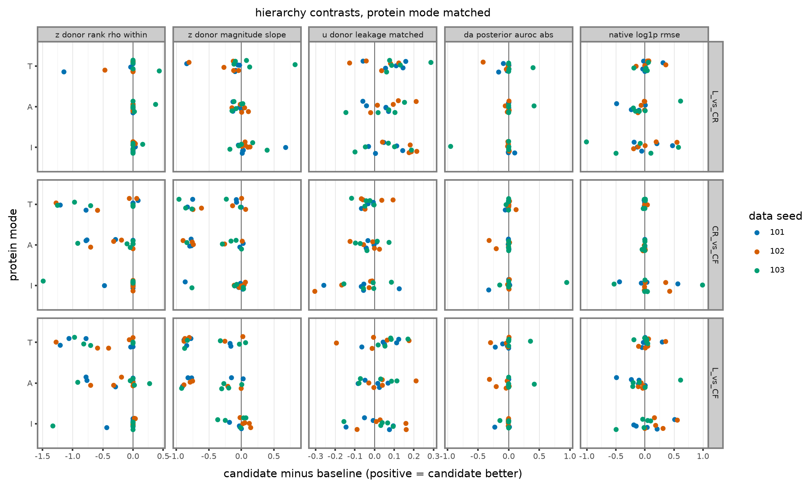
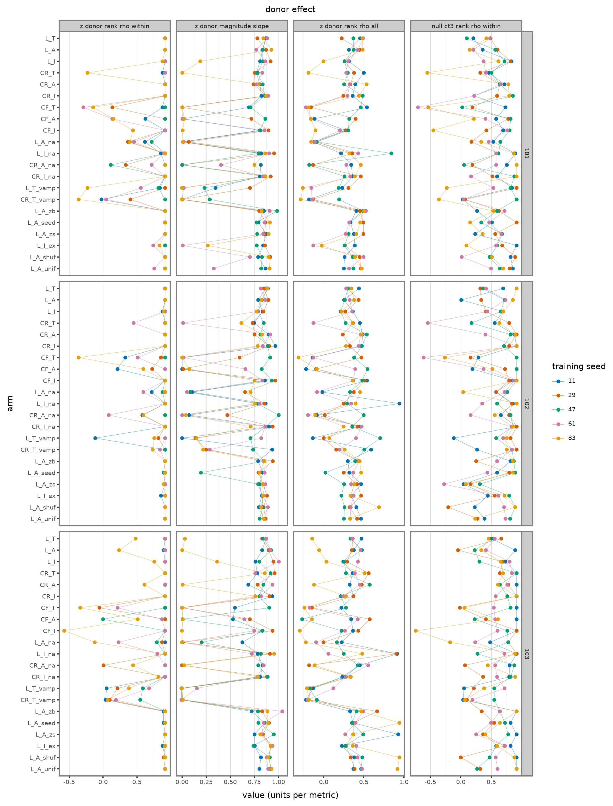
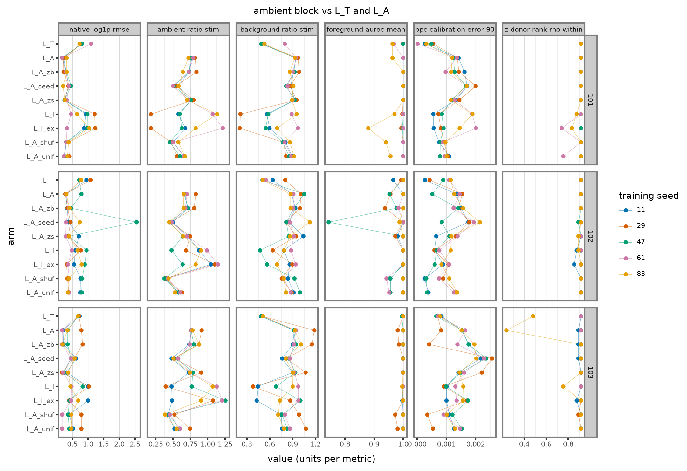
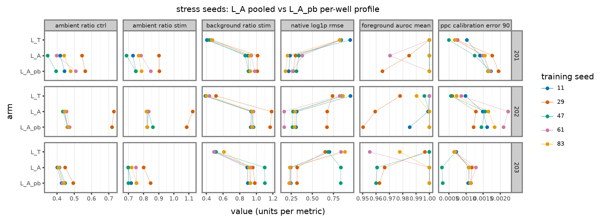
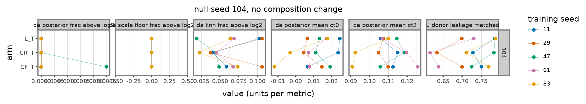

# ADR-0012: Keep the legacy hierarchy and current defaults after the simulation benchmark

## Status

Accepted on 2026-11-24. Evidence: a 375-fit simulation benchmark on mrtotalvi
`main` at 56eb248. The run folder is
`/exports/para-lipg-hpc/mdmanurung/mrtotalvi_bench/latent_ambient_20261124`; its
`logs/decisions.tsv` records every design choice.

## Context

Two open questions drove the benchmark. The first asks whether a different
hierarchy gives better `u` and `z` latents: `centered_v2` with the `raw_mean`
prior (CR) or `factual` prior (CF), against `legacy` (L). The second asks how the
opt-in ambient protein models of ADR-0011 perform against stock totalVI. A
VampPrior arm was added after the SysVI question.

The simulator plants four effects with known truth:

- a donor program in cell type ct1 (genes 10-19, log2 levels 0 to 1.5);
- a stimulation shift in ct0 and ct2 composition;
- induced proteins P15-P16 in stimulated ct1, with P17-P19 absent everywhere;
- free ambient ADT, three times higher in stimulated wells.

Each donor keeps 25% of its cells out of training, and every score is computed
on those held-out cells. The design has three main data seeds (101-103), a null
seed with no composition change (104), and three stress seeds with well-specific
ambient (201-203). Each arm is fitted with five training seeds (11, 29, 47, 61,
83) for 100 epochs.

The decision rule was fixed before the run. A hierarchy becomes the default only
if it wins both primary endpoints in all three main seeds: donor-effect rank rho
within condition, and donor-effect magnitude slope (ideal 1). It must also be
worse on no endpoint beyond twice the SD of paired training-seed differences.

## Decision

Keep every default: `hierarchy_mode="legacy"`, the current annealing, and
`protein_noise_model="totalvi"` with the ambient modes opt-in. Add no VampPrior
and no autotune support. No arm passed the rule, so no feature or default
change is validated.

## Evidence

### Hierarchy

No contrast passes the rule (`scores/decision_table.tsv`). CR matches L on every
endpoint shown. CR with isotype protein won both primary endpoints in all three
seeds, but it was worse on the ct3 ambient ratio, so the rule rejects it.

The main failure is a collapse of `z`: the magnitude slope falls to about 0, so
`z` no longer carries the donor program. Out of 15 fits per arm (three seeds by
five training seeds), the collapse counts (slope < 0.3) were:

| Arm | Collapsed fits | Median slope |
|---|---|---|
| CR_T_vamp | 13 | 0.01 |
| L_A_na (annealing off) | 12 | 0.05 |
| L_T_vamp | 11 | 0.14 |
| CF_T | 9 | 0.00 |
| CF_A | 8 | 0.07 |
| CR_A_na (annealing off) | 7 | 0.40 |
| L_T, L_A, L_I, CR_A | 1 each | 0.81-0.87 |

The factual prior, the VampPrior and switching annealing off all make collapse
common. The rank rho within condition saturates near its tie-limited ceiling of
0.916 in healthy fits, so it separates collapsed fits from healthy ones but not
healthy arms from each other.

### Ambient protein models

The ambient model (L_A) cuts the native-count error well below stock totalVI
(L_T). Values are medians over the 15 main-seed fits.

| Arm | Native log1p RMSE | Background ratio, stim | Ambient ratio, stim |
|---|---|---|---|
| L_T | 0.77 | 0.51 | none |
| L_A | 0.29 | 0.93 | 0.76 |
| L_A_zb (`z_base` background) | 0.32 | 0.92 | 0.73 |
| L_A_zs (`ambient_zscore`) | 0.29 | 0.92 | 0.74 |
| L_A_seed (seeded prior) | 0.45 | 0.85 | 0.51 |
| L_I (isotype) | 0.77 | 0.68 | 0.77 |
| L_I_ex (isotype, `excess`) | 0.69 | 0.73 | 0.90 |
| L_A_shuf (shuffled profile) | 0.38 | 0.78 | 0.44 |
| L_A_unif (uniform profile) | 0.39 | 0.87 | 0.60 |

The table supports four conclusions:

- The `z_base` and `ambient_zscore` options match L_A, so neither is promoted.
- The seeded prior underestimates ambient and once failed badly (seed 102).
- The isotype arms are noisier, and the `scale` form keeps a positive native
  floor, so their RMSE overstates the error.
- A wrong profile keeps most of the gain. Shuffled or uniform profiles raise
  the RMSE from 0.29 to 0.38-0.39 and bias the ambient ratio. The correct
  profile helps, but most of the benefit comes from the ambient term itself.

The ambient ratio stays below 1 (0.76), so L_A underestimates free ambient by
about a quarter.

With well-specific ambient, per-well profiles (L_A_pb) add nothing over the
pooled profile (median RMSE 0.27 against 0.30).

### Null calibration

On the null seed, posterior DA flags no cells above |log2| in any hierarchy.
In all three hierarchies `u` still separates the two donors that share condition
and well (median balanced accuracy 0.71-0.79, chance 0.5). The hierarchy choice
does not change this leak.

## Consequences

- Recommend `protein_noise_model="ambient"` with a pooled profile in the user
  guide when empty droplets exist. Keep it opt-in, because the gain was
  measured on simulated data only.
- Document that annealing off, the factual prior and the VampPrior risk a `z`
  collapse. A slope near 0 on a known donor effect detects it.
- Leave autotune out until it can target a validated endpoint. A tuner that
  optimises the ELBO would not see `z` collapse.
- Open items: the `u` donor leak on the null seed, and the 25% ambient
  underestimate.

## Limits

All data are simulated from one generator with 8 donors and 4 cell types. The
noise floor is wide because collapsed fits inflate the paired SD, which makes
the rule conservative. The rank endpoint saturates, so the slope carries most
of the information.
