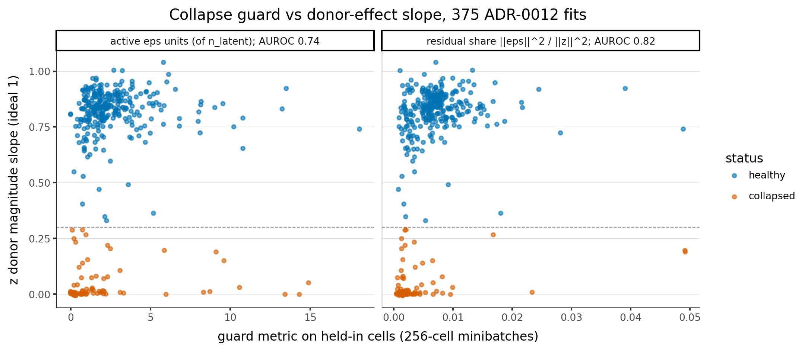

# ADR-0013: Add autotune support with a residual-collapse flag

## Status

Accepted on 2026-11-24 by owner decision. It supersedes the autotune line of
ADR-0012 ("add no autotune support"). The rest of ADR-0012 stands: every default
is unchanged. Evidence for the flag comes from the 375 ADR-0012 fits, scored in
`/exports/para-lipg-hpc/mdmanurung/mrtotalvi_bench/collapse_guard_20261124`.

## Context

ADR-0012 left autotune out because a tuner that optimises the ELBO would not see
a collapse of `z`. In a collapsed fit the donor residual `eps` shrinks to about 0,
and the donor-effect magnitude slope falls below 0.3. The owner chose to add
autotune anyway, with a metric that makes collapse visible to the tuner.

scvi-tools 1.5.2 `scvi.autotune.run_autotune` already accepts any model class with
a constructor and a `train` method. MrTotalVI only needs its `sample_key` passed to
the constructor.

## Decision

- `mrtotalvi.run_autotune(adata, metrics, mode, search_space, num_samples, **kwargs)`
  wraps `scvi.autotune.run_autotune` with `model_cls=MrTotalVI`. It sets
  `model_params["sample_key"]` from the setup registry and raises on a conflicting
  value. Every other argument and default is scvi-tools'.
- `MrTotalVAE.loss` logs two minibatch metrics as `<name>_train` and
  `<name>_validation`:
  - `residual_active_units`: the number of `eps` dimensions whose variance across
    the cells of the minibatch exceeds 0.01, the active-unit rule of Burda et al.
    (2016);
  - `residual_share`: mean ‖eps‖² / mean ‖z‖².
- When the primary metric ends in `_validation` or `_train`, the wrapper also
  reports both metrics to Ray for the same stage. They are reported, not
  optimised. scib-metrics targets pass through unchanged.
- The optional extra `mrtotalvi[autotune]` installs `scvi-tools[autotune]`
  (ray[tune], hyperopt, scib-metrics).

## Evidence

Both metrics were computed on the held-in cells of each ADR-0012 fit, in 256-cell
minibatches as training logs them. They were then set against the fit's
donor-effect magnitude slope: 293 healthy fits and 82 collapsed (slope < 0.3).

| Metric | AUROC, healthy vs collapsed | Median, healthy | Median, collapsed |
| --- | --- | --- | --- |
| `residual_share` | 0.82 | 0.0066 | 0.0020 |
| `residual_active_units` | 0.74 | 2.03 | 0.75 |

A low `residual_share` flags collapse, but the groups overlap. Below 0.003 it flags
68% of collapsed fits and 16% of healthy ones; below 0.005 it flags 84% and 27%.
`residual_active_units` separates less well.

## Consequences

- Treat the two metrics as a flag for trials that need a check, not as a filter.
  Rank trials by the ELBO, then check the donor effect of the chosen fits (for
  example, a known donor contrast) before use. A low `residual_share` relative to
  the other trials is the main warning sign.
- No threshold is recommended. The values above come from simulated data with 8
  donors and 4 cell types, and the scale of `residual_share` depends on `n_latent`
  and on the data.
- Ray claimed every CPU of a shared node and stalled at startup. Start Ray
  yourself with a CPU cap (`ray.init(num_cpus=...)`) and pass
  `ignore_reinit_error=True`.

## Limits

The flag was scored on finished fits, not on trials cut early by a scheduler such
as ASHA. A trial stopped after a few epochs may not yet show its final residual.
No real-data sweep has run.
