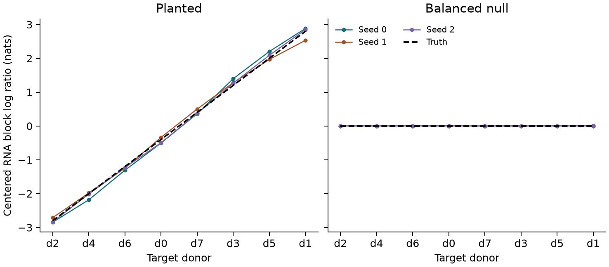

# MrTotalVI mathematical, statistical, and engineering assessment

**MrTotalVI can recover a donor-specific RNA signal in a controlled CITE-seq experiment.** I would use it to explore differences among donors represented in training. Its abundance scores lack a donor-level sampling model. Two silent input errors also affect which genes and cells enter an analysis.

I audited commit `58cb7f1d4c75e5493c0f9f11d2b1f9d97cd329a5` on November 21–22, 2026. I ran the CPU suite, tested public methods against counterexamples, and fit six models. I used Python 3.12.13, scvi-tools 1.5.2, PyTorch 2.15.0, and Lightning 2.6.6. The assessment covers the public AnnData workflow. GPU execution and performance on an independent human cohort remain unverified.

## What the model estimates

The default RNA likelihood is negative binomial. The protein likelihood mixes background and foreground negative binomials and includes protein-specific batch efficiencies. These choices have a sound basis for paired RNA and antibody counts. MrTotalVI connects them to a sample-aware latent hierarchy inspired by MrVI. The two original papers test their respective models. The hybrid needs its own evidence. [totalVI paper](https://www.nature.com/articles/s41592-020-01050-x) · [MrVI paper](https://www.nature.com/articles/s41592-025-02808-x)

For one cell, the default encoder estimates a diagonal Gaussian over its base state, conditional on its counts **and its observed sample**. The decoder receives a projection of that state plus a learned sample-specific residual. Changing the target sample holds the inferred base state fixed. The resulting contrast answers how the fitted decoder changes its prediction for that cell. Donor identity can also enter the base state. A treatment effect or donor-neutral cell identity therefore requires evidence beyond the reconstruction fit. Perfect donor–batch confounding cannot be resolved by changing which label enters the network. [Encoder](../../../src/mrtotalvi/_components.py#L679) · [Hierarchy](../../../src/mrtotalvi/_module.py#L689)

The default objective combines the count losses, the base-state KL, and a Gaussian penalty on the fitted residual. For residual dimension `d` and fixed isotropic scale `σ`, the last term is `||ε||²/(2σ²) + d log(σ) + constant`. It evaluates a density at a point. This maximum a posteriori (MAP) penalty makes the default objective a penalized fit. Ranking priors or architectures by the reported `elbo` would give a misleading model comparison. Legacy `use_map=False` adds residual posterior entropy through an analytic Gaussian KL. The Gaussian base prior also has an analytic KL. The mixture and Vamp priors estimate the base KL by sampling. By default, warm-up scales the protein likelihood alongside several KL terms. Runs that finish at different warm-up weights have optimized different modality trade-offs. [Prior calculation](../../../src/mrtotalvi/_components.py#L372) · [Objective](../../../src/mrtotalvi/_module.py#L1020) · [Training schedule](../../../src/mrtotalvi/_model.py#L967)

In stochastic legacy mode, the residual posterior uses the sample label. Its Gaussian prior is shared across samples. With the unsupervised base prior and fixed technical context, drawing from both priors gives the same prior-predictive count distribution across donors. The distinction matters when interpreting a transformation that uses a fitted donor embedding. [Residual posterior](../../../src/mrtotalvi/_components.py#L1207) · [Residual prior](../../../src/mrtotalvi/_module.py#L1037)

The optional centered hierarchy subtracts each cell’s mean residual over all registered samples. Its residuals therefore sum to zero for that cell. This fixes the reference for reporting. It does not determine which differences are biological. Posterior draws condition on fitted weights and registered targets. A seed-to-seed SD measures optimization variability. Neither measures uncertainty from sampling new donors. The seed combiner appropriately avoids averaging unaligned latent coordinates. [Centering](../../../src/mrtotalvi/_module.py#L663) · [Seed summaries](../../../src/mrtotalvi/_seed.py#L184)

## A donor effect with known magnitude

I reused the package’s generator and added a cell holdout and a balanced null. The fixture has eight donors, two states, one batch, 48 genes, and eight proteins. Two RNA gene blocks encode the donor contrast. Proteins carry state information. Each fit used 384 training cells and 128 held-out cells from the same donors. I fit the default hierarchy for 100 epochs with 20 epochs of KL warm-up. I used training seeds 0, 1, and 2 for both designs. In the null, every artificial donor had the same mix of original donors and states in each split. [Generator](../../../tests/test_mrtotalvi.py#L2543) · [Review experiment](donor_check.py)

For each held-out cell, I decoded all eight target donors at the same batch and library size. I calculated the log ratio of the two blocks’ summed RNA rates. I averaged this quantity over the same cells for every target and centered the eight results. Comparing decoded counts avoids comparing latent coordinate scales across fits. [Per-donor results](donor_check.tsv)



All three fits recovered the planted ordering exactly. The true donor span was **5.60** natural-log units. The fitted spans were **5.73, 5.24, and 5.69**. The largest null span was **0.00792**. This demonstrates recovery of a strong RNA effect on new cells from known donors. The experiment leaves small effects, protein-specific shifts, unequal donor yields, batch confounding, and new donors open. Stock totalVI was outside this six-fit comparison. [Figure](donor_check.png) · [Numerical results](donor_check.tsv)

Simple donor-level pooling recovered the same ordering from the 384 training cells. Its estimated span was **5.610** and its root mean squared error across donors was **0.014**. The model’s corresponding errors were **0.135, 0.114, and 0.058**. The model learned the contrast, but direct count aggregation estimated its magnitude more accurately in this balanced design. This comparison concerns the one planted contrast. It does not assess the added value of cell-specific modeling in heterogeneous states. [Count baseline and model calculation](donor_check.py)

## Differential abundance and expression

The default abundance score treats each sample as an equal-weight mixture of its cells’ latent posteriors. It evaluates those densities near a query cell. Within a group it averages the included sample densities. Narrow posterior scales can place almost all density on isolated cells. A precise encoder can therefore produce unstable abundance scores even when all samples share the same population. [Estimator](../../../src/mrtotalvi/_stats.py#L273)

In the package’s two-dimensional null fixture, four samples each had 600 cells and identical generating distributions. The across-cell SD of the A-versus-B score was **10.652 nats** under the default. It fell to **0.210** with a scale floor of 0.4 and **0.295** with 50 nearest neighbors. This test sets latent values directly. These numbers measure estimator behavior independently of training. The floor changes the smoothing scale. The neighbor method also pools cells, giving greater group weight to samples with more cells. Its fixed pseudocount matters most for small samples. The three methods need distinct interpretations. [Fixture](../../../tests/test_da_density_estimator.py#L40) · [Group aggregation](../../../src/mrtotalvi/_stats.py#L571)

Use those scores to locate patterns worth testing. Population-level DA needs independent biological replicates, an explicit denominator, and the study’s pairing or blocking scheme. Public differential expression correctly refuses to issue cell-level p-values. The private Wald implementation and model-derived RNA ratios do not supply a calibrated treatment test. A donor-by-condition count analysis provides a separate inferential route. [Public DE method](../../../src/mrtotalvi/_model.py#L1451) · [Replicate benchmark](https://pubmed.ncbi.nlm.nih.gov/34584091/)

## Engineering findings

| Priority | Reproduced behavior | Consequence and repair |
|---|---|---|
| High | Reversing the RNA gene order on an equal-width query returned finite, changed cell states without a gene-order warning. A one-epoch model’s maximum absolute change in `u` was 0.369 for the same cells. Public setup also accepted conflicting protein DataFrame and `uns` names. | Counts can be assigned to the wrong genes or antibodies. Check ordered RNA names on transfer and load. Reuse the existing protein-name consistency check during public setup. [Transfer](../../../src/mrtotalvi/_model.py#L1933) · [Protein-name check](../../../src/mrtotalvi/_contracts.py#L294) |
| High | A legacy model trained with donor cell counts `[3, 3, 0]` returned a finite target representation for the third donor. | Registration currently counts as support. Check the resolved training split and persist factual cell counts for each target. Flag or reject targets with zero training cells. [Registration counts](../../../src/mrtotalvi/_model.py#L424) · [Train guard](../../../src/mrtotalvi/_model.py#L832) |
| High for held-out evaluation | With 16 proteins, multiplying counts in only the 10 reserved cells by 20 moved the initialized protein-background location from **1.730 to 2.371**. The other 30 cells and random seed stayed fixed. | The inherited empirical background uses the full registered dataset before the split. scvi-tools 1.5.2 enables it by default above ten proteins. Estimate it from training rows for an independent test. The train-only Vamp initialization covers a different prior. The downstream effect size of this leakage is unmeasured. [Constructor](../../../src/mrtotalvi/_model.py#L395) · [Split handling](../../../src/mrtotalvi/_model.py#L851) |
| High for cell subsets | With both `sample` and a boolean cell mask, `get_aggregated_posterior` can return another cell’s mixture component. A mask selecting row 3 returned row 0’s posterior exactly. | The code intersects boolean values with integer row positions. Convert the mask to positions before intersecting. Until fixed, pass `np.flatnonzero(mask)` explicitly. [Index handling](../../../src/mrtotalvi/_stats.py#L125) |
| Conditional on ZINB | With zero-inflation probability fixed at 0.5, the counterfactual API returned an RNA rate sum of **52**. The expected observed count sum was **26**. | `rna_rate` is the NB component mean. The public method promises an expectation. Return or label both quantities under ZINB. The public predictive sampler rejects ZINB, while the exported low-level sampler always draws NB. The default NB fit avoids this mismatch. [API promise](../../../src/mrtotalvi/_model.py#L1329) · [Decoder](../../../src/mrtotalvi/_module.py#L1305) · [Low-level sampler](../../../src/mrtotalvi/_module.py#L955) |

### Other implementation limits

- **Model selection.** With `scale_observations=True`, training weights donors through the scalar loss. The components supplied to the default `elbo_validation` monitor remain cell-weighted. A donor-rich sample can dominate early stopping even when the optimizer weights donors equally. Log the validation criterion for the scientific weighting actually chosen. [Weighting and metrics](../../../src/mrtotalvi/_module.py#L1068)
- **Optional invariance penalty.** With identical donor embeddings, the penalty was zero under MAP and 0.0333 with stochastic residuals in a fixed-weight probe. Two independent residual draws can create a penalty without a donor difference. Use matched draws or deterministic residual means for the counterfactual consistency comparison. [Penalty](../../../src/mrtotalvi/_module.py#L1184) · [Residual draw](../../../src/mrtotalvi/_components.py#L1228)
- **Memory.** Sparse input validation processes the entire stored array at once. The legacy outlier cutoff also evaluates all pairs within each target reference. At 5,000 cells and ten latent dimensions, one broadcast float32 intermediate alone is about 0.93 GiB. Smaller query batches do not bound that cutoff calculation. The v2 scorer already shows how to chunk this operation. [Count scan](../../../src/mrtotalvi/_contracts.py#L146) · [Cutoff](../../../src/mrtotalvi/_stats.py#L1301) · [Chunked scorer](../../../src/mrtotalvi/_counterfactual.py#L588)
- **Documentation.** For a focal cell with centered residual `a`, the cheapest raw-mean excess penalty is `a²/[2σ²(S−1)]`. The factual penalty is `a²/(2σ²)`. The guide reverses which option is cheaper. It also attributes most historical seed instability to warm-up even though the prior changed simultaneously. That experiment cannot identify either change’s contribution. [Penalty derivation](../../adr/0007-mrtotalvi-v2-centered-counterfactuals.md#L89) · [Penalty wording](../../user_guide.md#L412) · [Historical comparison](../../user_guide.md#L449)

## Regression coverage and next decision

The full CPU suite returned **393 passed, 1 skipped, 1232 warnings** in **370.85 seconds**. Coverage includes frozen checkpoint replay, explicit label-supervision contracts, a planted-donor recovery test, and count-validation failures. The CUDA test needs a separate run. The private human-data comparator is a one-epoch engineering check. The package permits `scvi-tools>=1.5.2` and overrides version-specific internals. This review establishes compatibility with the installed version only. [Oracle test](../../../tests/test_mrtotalvi_v2.py#L277) · [CPU donor test](../../../tests/test_mrtotalvi.py#L2620) · [Human comparator scope](../../../tests/engineering/README.md) · [Dependency declaration](../../../pyproject.toml)

**Fix feature alignment first.** One reordered input can corrupt every downstream result while producing plausible values. Next, enforce training support and split-isolated preprocessing before comparing predictive scores. For a stronger scientific claim, compare the frozen model against stock totalVI and a donor-count baseline on an independent cohort with crossed batches. Include donor-level negative controls, a protein-specific signal, and multiple seeds. The current evidence supports within-cohort exploration.

To rerun the six fits and regenerate the figure, use the repository root and its test environment.

```bash
OMP_NUM_THREADS=1 MKL_NUM_THREADS=1 OPENBLAS_NUM_THREADS=1 PYTHONPATH=. \
  .venv/bin/python docs/reviews/2026-11-21/donor_check.py
```
