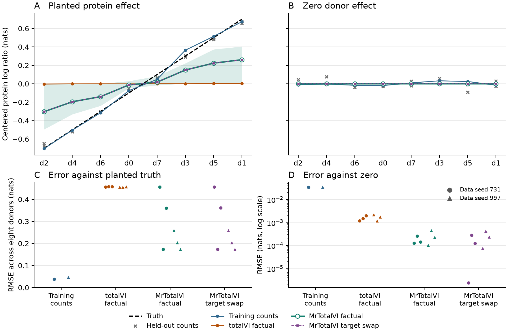
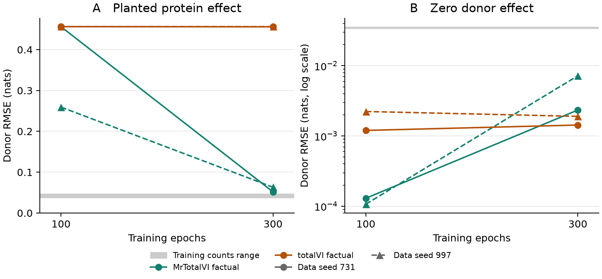
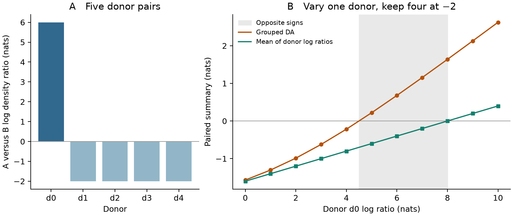

# Donor protein recovery and paired abundance scores

Longer training brought MrTotalVI close to the planted donor protein effect on both simulated datasets. Pooling counts within batch and state still gave smaller errors. Two public abundance summaries also gave opposite signs for the same five donor pairs. [Training duration, panel A](protein_epochs.png) · [Paired abundance, panels A and B](paired_da_check.png)

## Protein recovery across batches

The target was each donor’s log ratio of two antibody means. I calculated the ratio within each batch and cell state. I averaged the four log ratios equally and centered the result across eight donors. The true donor values ranged from −0.70 to +0.70 nats. The negative control set every donor effect to zero. Both designs retained the same batch imbalance and state effects. [Generator and estimator](protein_check.py)



**Panels A and B.** Lines show mean estimates across data draws and training seeds. Gray crosses show both independent held-out count estimates. The shaded band spans all six MrTotalVI fits at each donor. Factual estimates use each training cell’s own donor. The target swap decodes the same 256 balanced training cells under every donor label. On the planted data, the two profiles differed by at most 0.00083 nats per donor. [Panels A and B](protein_check.png) · [Donor estimates](protein_check.tsv)

**Panels C and D.** Each point gives root mean squared error across eight donors. Shapes distinguish independent count draws. Each model has three training seeds per draw. Panel D uses a log scale to show differences near zero. [Figure](protein_check.png) · [Donor estimates](protein_check.tsv)

At 100 epochs, the median fitted donor span was **0.661 nats** for MrTotalVI. Individual spans ranged from **0.00684 to 0.900** against a true span of **1.40**. Pooling training counts gave spans of **1.308 and 1.450**. Stock totalVI’s median fitted span was **0.00696** under the matched schedule. Median donor RMSE was **0.043** for counts, **0.232** for MrTotalVI and **0.457** for totalVI. The independently measured donor spans were **1.323 and 1.329**. [Panels A and C](protein_check.png) · [Donor estimates](protein_check.tsv)

Under the null, every factual MrTotalVI fit had donor RMSE below **0.00046** nats. Pooling training counts gave **0.0343 and 0.0357**. Shrinkage helped when the true effect was zero and understated the planted effect. This comparison measures error for one protein contrast. [Panels B and D](protein_check.png) · [Donor estimates](protein_check.tsv)

### Sensitivity to training duration

After one primary fit nearly erased the planted effect, I refit both models for 300 epochs. I kept training seed 0, both data draws, the matched optimizer and the original warm-up. Both the planted and null designs entered this follow-up. The 24 primary fits and eight follow-up fits all reached their assigned epoch budgets. [Run settings](protein_check.py)



**Panel A.** MrTotalVI donor RMSE fell from **0.456 to 0.052** on data draw 731. It fell from **0.259 to 0.063** on draw 997. The corresponding donor spans reached **1.518 and 1.230** against a true **1.400**. The gray band shows the training-count errors of **0.038 and 0.047**. Stock totalVI remained near **0.456** on both draws. Scoring against the independent test counts also favored pooling on both draws. [Training duration, panel A](protein_epochs.png) · [300-epoch estimates](protein_epochs.tsv) · [100-epoch and count estimates](protein_check.tsv)

**Panel B.** Under the null, longer training increased MrTotalVI RMSE to **0.00234 and 0.00719**. Both stayed below the count baseline. The training-length check used one optimization seed. It shows that the near-zero fit at 100 epochs could recover with more updates. It leaves the best stopping point unresolved. [Training duration, panel B](protein_epochs.png) · [300-epoch estimates](protein_epochs.tsv)

### Data and scoring

Every donor had two states and appeared in both batches. Each donor supplied 24 training cells per state in one batch and eight in the other. Positive-level donors favored the second batch. Negative-level donors favored the first. Every test stratum had 12 fresh cells. Only the 512 training cells entered registration, initialization and fitting. The 384 test cells supplied an independent count estimate. Applying the estimator to the generating means recovered the analytic truth within `1e-12`. [Simulation and split](protein_check.py)

The simulated log ratio was the sum of donor, state and batch terms. The state term was ±0.3 nats. The batch term was ±0.8 nats. The two antibody counts were independent Poisson draws with means `16 exp(±log_ratio / 2)`. RNA and six other antibodies carried no conditional donor effect. Their counts matched exactly between the planted and null designs within each data draw. State labels were used only to balance anchors and score donor profiles. [Generator](protein_check.py)

Both models used a 30-dimensional decoder latent, 128-cell minibatches, Adam at 0.002 and a 20-epoch KL warm-up. The learning rate stayed fixed. MrTotalVI used its default sample-conditioned hierarchy. Stock totalVI used its own encoder and prior with the matched optimizer. The empirical protein background prior was off for both. The data seeds were 731 and 997. The primary training seeds were 0, 1 and 2. [Fit settings](protein_check.py)

Both models used the same count scale. Stock totalVI decoded the posterior mean of `z`. MrTotalVI evaluated its donor-specific `z` at the posterior mean of `u`. At that latent, `α` and `β` are the Gaussian log-background mean and standard deviation. Let `p` be background probability and `f` the foreground multiplier. The fitted total protein mean is `efficiency × exp(α + β²/2) × [p + (1 − p)f]`. This integrates the lognormal background and both mixture components. [Decoder calculation](protein_check.py) · [Package decoder](../../../src/mrtotalvi/_module.py#L1208) · [totalVI model](https://docs.scvi-tools.org/en/1.5.2/user_guide/models/totalvi.html#inference)

## Two paired abundance summaries

At one query cell, four donors favored B by 2 nats each. One donor favored A by 6 nats. On the same `centered_v2` fixture, `differential_abundance()` gave **+0.680** for A versus B. The `donor_log_ratio_mean` from `local_sample_enrichment()` gave **−0.400**. Each sample started with three identical Gaussian components. Removing the query left two identical components in its own sample. [Panels A and B](paired_da_check.png) · [API outputs](paired_da_check.tsv)



For a complete pair, let `r_d = log p_A(x) − log p_B(x)`. Centering within donor leaves `+r_d/2` and `−r_d/2`. Grouped DA then averages the exponentiated scores before taking their log ratio. With finite reference densities, the two formulas are

```text
grouped DA       = logsumexp(r / 2) − logsumexp(−r / 2)
paired donor mean = sum(r) / number of donors
```

With four ratios fixed at −2, the grouped score crosses zero when the fifth reaches **4.504**. The paired mean crosses zero at **8**. Both public APIs matched their formulas within `6e-7` nats across 11 inputs. The fixture fixed the encoder posteriors to Gaussians with known densities. It tests aggregation without training noise. For the average within-donor log ratio, use `donor_log_ratio_mean` and inspect `donor_log_ratio` for the spread. Both outputs are descriptive. [Panel B](paired_da_check.png) · [Runnable check](paired_da_check.py) · [Group aggregation](../../../src/mrtotalvi/_stats.py#L571) · [Paired mean](../../../src/mrtotalvi/_counterfactual.py#L2225)

## Scope and reproduction

The guide now distinguishes the two paired summaries. It also corrects the centered residual penalty. With `S > 1` and fixed scale `σ`, a factual residual `a` costs `||a||²/(2σ²)` above the zero-residual penalty. The smallest raw-mean cost is that value divided by `S − 1`. For three samples with raw residuals `[1, −0.5, −0.5]` and unit scale, the package test returned excess costs of 0.50 and 0.25 respectively. The focused CPU checks passed all 28 cases covering these costs, abundance scoring and protein decoding. [User guide](../../user_guide.md) · [Closed-form test](../../../tests/test_review_fixes.py#L746)

The package source was `58cb7f1d4c75e5493c0f9f11d2b1f9d97cd329a5`. The CPU runs used Python 3.12.13, scvi-tools 1.5.2, PyTorch 2.15.0 and Lightning 2.6.6. Replaying both 100-epoch models at data seed 731 and training seed 0 reproduced all 24 saved donor estimates. The protein experiment uses fixed, known donors and Poisson counts. New-donor prediction, overdispersed measurements and independent-cohort performance remain open. The preceding review records the RNA experiment and the open input-validation findings. [Earlier assessment](../2026-11-21/assessment.md)

Run from the repository root with the package test environment.

```bash
export PYTHONPATH=. OMP_NUM_THREADS=1 MKL_NUM_THREADS=1 OPENBLAS_NUM_THREADS=1 MPLBACKEND=Agg
.venv/bin/python docs/reviews/2026-11-22/protein_check.py
.venv/bin/python docs/reviews/2026-11-22/paired_da_check.py
.venv/bin/python -m pytest -q tests/test_da_density_estimator.py \
  tests/test_review_fixes.py::test_residual_prior_modes_have_closed_form_costs \
  tests/test_review_fixes.py::test_group_and_donor_summaries_skip_nan_sample_densities \
  tests/test_mrtotalvi_v2.py::test_counterfactual_expression_schema_specified_library_and_protein_means \
  tests/test_mrtotalvi_v2.py::test_local_sample_enrichment_self_exclusion_singletons_and_group_logmeanexp
```
