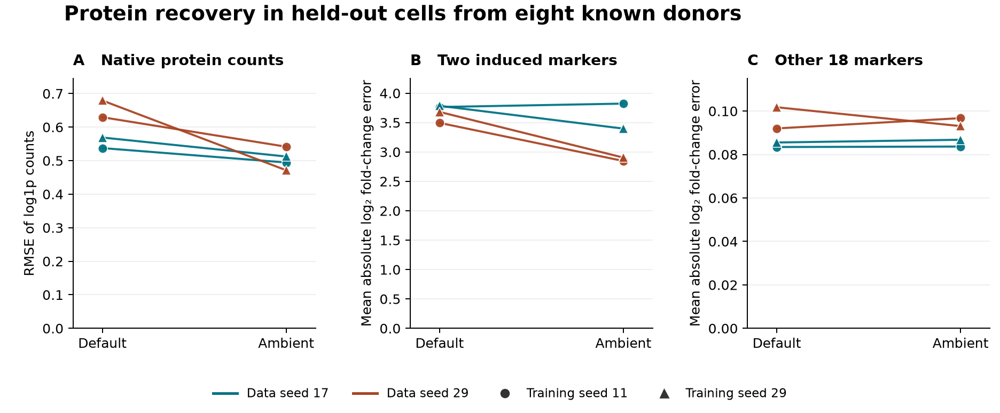
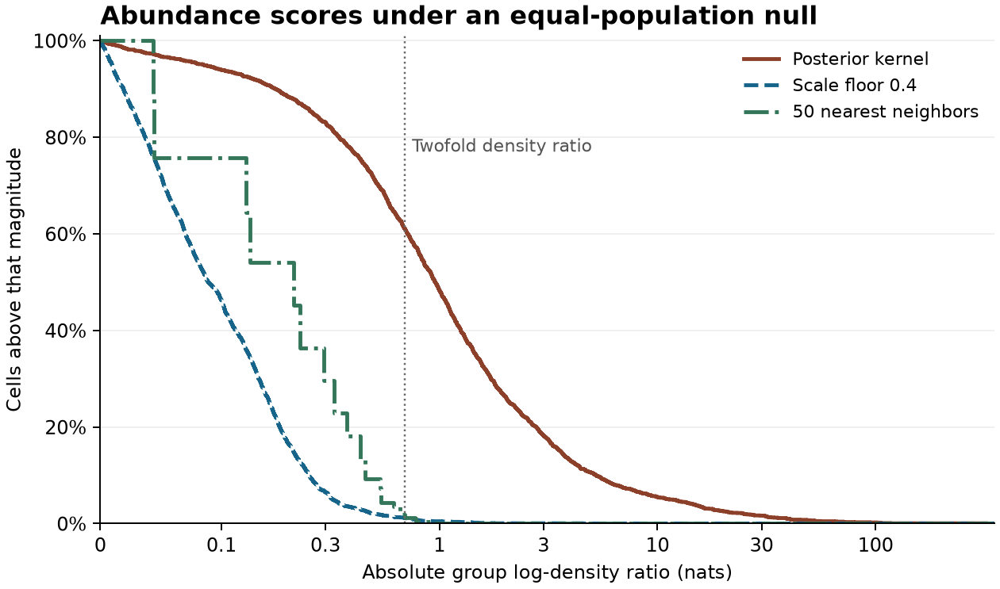

# MrTotalVI statistical, mathematical and engineering review

**Fix feature identity and training-split handling before trusting a donor comparison.** MrTotalVI can recover planted effects in cells from known donors. The current package can also assign counts to the wrong features, select the wrong cell, and report support for a donor with no training cells. Its abundance scores describe the fitted data. Population-level treatment effects need independent biological replicates.

I reviewed `feat/ambient-protein-noise` at `987efdf44e2af090cb53e564a9c58b06c7952eea`. The CPU suite returned **418 passed, 1 skipped, 1583 warnings in 597.87s**. The skipped test requires CUDA. I also ran public-API counterexamples and eight matched fits on new simulated data. The environment used Python 3.12.13, scvi-tools 1.5.2, PyTorch 2.15.0 and Lightning 2.6.6. Independent human-cohort performance and GPU execution remain unverified here. [CUDA test](../../../tests/test_standalone_regressions.py#L40) · [Scope of the repository’s human-data smoke test](../../../tests/engineering/README.md)

A concurrent commit, `37bd399962111552ea63d8461d269dcc3e3c69f6`, arrived after the full-suite run. It corrects isotype column removal for numeric protein names in the decomposition. I inspected its diff and reran the entire ambient test file at that commit. **26 passed**. The inherited foreground API tested below uses a different path. [Follow-up regression test](../../../tests/test_ambient.py#L307)

The package already checks raw counts exhaustively during public setup. Its tests check centered latent values and gradients across chunk sizes, and replay frozen legacy checkpoints. Those checks protect specific behaviors. They should stay in place as the issues below are fixed. [Count checks](../../../src/mrtotalvi/_contracts.py#L153) · [Chunking checks](../../../tests/test_mrtotalvi_v2.py#L629) · [Checkpoint replay](../../../tests/test_mrtotalvi_v2.py#L254)

## Highest-priority corrections

  | Finding                                                                    | What happened on this checkout                                                                                                                                                                                                                                                                                                                          | Proposed fix and acceptance check                                                                                                                                                                                                                                                                                                                                                                                                                                                             |
  | -------------------------------------------------------------------------- | ------------------------------------------------------------------------------------------------------------------------------------------------------------------------------------------------------------------------------------------------------------------------------------------------------------------------------------------------------- | --------------------------------------------------------------------------------------------------------------------------------------------------------------------------------------------------------------------------------------------------------------------------------------------------------------------------------------------------------------------------------------------------------------------------------------------------------------------------------------------- |
  | **RNA and protein identities can be wrong.**                               | Reversing five RNA columns on a query changed its base latent by up to **0.396**. The call returned normally. Public setup also registered `p15, p14, …` for a protein DataFrame beginning `p0, p1, …` when `uns` disagreed.                                                                                                                            | Check unique, ordered RNA names at registration, transfer and load. Reuse the existing protein-name validator before public setup. Test an equal-width permutation and conflicting authorities. Require an error before decoding or registration. [Query validation](../../../src/mrtotalvi/_model.py#L1999) · [Protein-name validator](../../../src/mrtotalvi/_contracts.py#L240)                                                                                                            |
  | **A cell selection can return another cell.**                              | A boolean mask selected row 3 within its donor. `get_aggregated_posterior` returned row 0’s posterior. On disk-backed data, the foreground probabilities labelled `cell7, cell1, cell4` exactly matched the positional output for `cell1, cell4, cell7`. The largest error after matching labels was **0.152**.                                         | Convert masks to positions before sample intersection. Share the backed loader’s sort-and-restore logic across public outputs. Check unsorted requests, repeats and masks against named rows in memory and on disk. For backed subsampling, select the requested observations before sorting. [Posterior selection](../../../src/mrtotalvi/_stats.py#L118) · [Existing row-order helper](../../../src/mrtotalvi/_stats.py#L57) · [Expression wrapper](../../../src/mrtotalvi/_model.py#L1694) |
  | **A registered donor can have zero factual training cells.**               | A one-epoch `centered_v2` fit had training counts `[3, 3, 0]`. The third donor produced finite counterfactuals for both queries. Both had `target_support=True`, and one passed `admissible`. The default reference included its validation cells. Centering can update that donor’s residual indirectly. Its observed response never entered training. | Resolve the actual split before fitting. Save per-donor training counts and the split identity. Refuse unsupported targets by default. Keep training support separate from overlap with the chosen reference. Check explicit splits, random splits and checkpoint reloads. [Registration counts](../../../src/mrtotalvi/_model.py#L424) · [Training split](../../../src/mrtotalvi/_model.py#L801) · [Reference support](../../../src/mrtotalvi/_counterfactual.py#L574)                       |
  | **Held-out proteins can change the starting model.**                       | I kept 30 training rows fixed. Multiplying only the 10 reserved rows by 20 moved the initialized background location from **1.528 to 1.951**. Above ten proteins, scvi-tools 1.5.2 enables its empirical prior by default. It computes the prior during construction. Its effect on final accuracy was not measured by this probe.                      | Estimate data-derived priors, empirical missingness masks and weighting denominators from training rows when evaluating a holdout. Keep supplied experimental panel masks distinct. Alter only held-out values and require identical initial parameters, masks and training weights. The existing training-only Vamp initialization supplies a precedent. [Constructor](../../../src/mrtotalvi/_model.py#L397) · [Vamp split handling](../../../src/mrtotalvi/_model.py#L545)                 |
  | **Isotype controls can have arbitrary reported foreground probabilities.** | In `ambient_isotype`, both count components have identical means for a control. With fixed draws, switching only its mixing-head bias from −12 to +12 moved its public foreground probability from **0.999994 to 0.000006**. The loss stayed **1742.033203125**. Its reported normalized expression changed from **0.712 to 0.0000044**.                | Use one control mask in every native-expression and foreground API. Emit zero native signal and omit or mark undefined control probabilities. Keep controls available for measurement diagnostics. Test by changing only control logits and checking every public output. [Rate construction](../../../src/mrtotalvi/_module.py#L1363) · [Control penalty mask](../../../src/mrtotalvi/_module.py#L841) · [Public expression wrapper](../../../src/mrtotalvi/_model.py#L1673)                 |

## What the model estimates

**Changing donor labels estimates a fitted decoder contrast.** The default encoder infers a diagonal Gaussian for `u` from counts and the observed sample. The decoder uses `z = z_base(u) + eps(u, target)`. A target swap holds inferred `u` fixed. Donor information already in `u` survives the swap. `sample_blind` removes the explicit donor input. Counts and technical covariates can still encode donor identity. Centering the residuals makes their average zero over registered samples. It cannot resolve a donor perfectly confounded with batch. Correct the README’s “sample-free cell state” example. Evaluate donor predictability within cell type and known biological signal across crossed batches. [README example](../../../README.md#L45) · [Encoder](../../../src/mrtotalvi/_components.py#L670) · [Centering](../../../src/mrtotalvi/_module.py#L613) · [MrVI paper](https://www.nature.com/articles/s41592-025-02808-x)

**The default loss is a penalized objective.** For residual dimension `d` and Gaussian scale `σ`, the MAP term is `||eps||²/(2σ²) + d log(σ) + constant`. It scores a fitted point. Legacy `use_map=False` restores the residual posterior entropy through a Gaussian KL. The standard Gaussian base prior also has an analytic KL. The mixture and Vamp priors use Monte Carlo for that term. `get_elbo` cannot rank arbitrary prior scales or architectures by marginal likelihood. Report the fitted objective, validate predictive quantities on untouched data, and keep the existing `get_marginal_ll` refusal. Posterior draws condition on fitted weights. Variation across training seeds measures optimization variability. Neither supplies a donor sampling interval. [Loss](../../../src/mrtotalvi/_module.py#L996) · [Base KL](../../../src/mrtotalvi/_components.py#L367) · [Marginal-likelihood guard](../../../src/mrtotalvi/_module.py#L929)

**Centering changes the effective residual penalty.** For `S > 1` registered samples, hold one centered residual at `a`. Under a fixed isotropic prior, the factual penalty above its value at zero is `||a||²/(2σ²)`. The minimum raw-mean penalty over compatible raw residuals is `||a||²/[2σ²(S−1)]`. A fitted network can pay more than this minimum. Changing the number of registered samples therefore changes the weakest available shrinkage. Report the sample universe and penalty mode when comparing fits. [Derivation](../../adr/0007-mrtotalvi-v2-centered-counterfactuals.md#centered-hierarchy-and-training-penalty) · [Closed-form test](../../../tests/test_review_fixes.py#L716)

**The monitoring criterion can select a different fit from the chosen training objective.** `scale_observations=True` weights the scalar loss by donor. The components logged for default early stopping retain cell weights. The global embedding penalty also uses the registered cell count in the training loss. During default warm-up, the protein likelihood enters with the KL weight. Large runs can finish with that weight below one. Log donor-balanced validation loss, the component losses and the terminal KL weight. Check an imbalanced split where cell-weighted and donor-weighted rankings reverse. Compare annealing schedules with matched training budgets before changing defaults. [Weighting](../../../src/mrtotalvi/_module.py#L1035) · [Training schedule](../../../src/mrtotalvi/_model.py#L902) · [Training guide](../../user_guide.md#inherited-training-defaults)

**The optional invariance penalty can measure residual noise.** I made every donor embedding identical in the sample-blind test fixture. The penalty was **0** with deterministic residuals and **0.02455** with `use_map=False`. The latter draws independent residuals for the two decodes. Use residual means or common random draws and require zero when the donors are identical. Separately, the inherited adversary can turn on for all-zero panel entries. It acts on `z`, which includes the donor residual. Cross donors and batches before attributing loss of donor signal to the residual prior. [Penalty calculation](../../../src/mrtotalvi/_module.py#L1148) · [Residual sampler](../../../src/mrtotalvi/_components.py#L1223) · [Training warning](../../../src/mrtotalvi/_model.py#L913)

**Two quantities called priors deserve different scaling checks.** The batch–protein efficiency is shared across cells. Its lognormal penalty enters once per cell in that batch. Summed across the dataset, it contributes `n_batch_cells × (−log p(efficiency))`. Decide whether that term represents a per-cell regularizer or a single prior on a shared parameter. For the latter, count it once and version the objective. Separately, the inherited empirical background initializer uses `sqrt(sum(s_i²))/n` across sampled cells. With identical protein rows, increasing sampled cells from 25 to 100 halved the initialized SD from **0.05176 to 0.02588**. If the intended prior describes backgrounds across cells, estimate that spread, including between-cell location variation. Keep uncertainty in the average as a separate statistic. [Efficiency penalty](../../../src/mrtotalvi/_module.py#L833) · [Protein model specification](../../adr/0011-ambient-aware-protein-model.md#generative-model) · [Inherited prior entry point](../../../src/mrtotalvi/_model.py#L397)

### Protein noise and RNA predictions

The default RNA negative-binomial likelihood handles overdispersion. The protein likelihood mixes two negative binomials with shared dispersion. Its fitted mixture mean correctly includes batch efficiency. For protein background `B`, foreground multiplier `f` and background probability `π`, that mean is `efficiency × E[B] × [1 + (1−π)(f−1)]` at fixed latent state. For a lognormal background, `E[B] = exp(α + β²/2)`. The new ambient mode adds `efficiency × c × a` to that mean, where `a` is the empty-droplet composition. The package tests this identity. [Decoder](../../../src/mrtotalvi/_module.py#L1349) · [Mixture-mean check](../../../tests/test_ambient.py#L229) · [totalVI paper](https://www.nature.com/articles/s41592-020-01050-x)

**The counts constrain the sum more directly than its components.** At a fixed cell, the ambient-mode component rates before efficiency are `c a + B` and `c a + B f`. For a small shift `δ`, set `c′ = c + δ` and `B′ = B − δa`, keeping `c′` and every `B′` positive. Setting `f′ = 1 + B(f−1)/B′` preserves both rates, protein by protein. This is a conditional ambiguity. Shared decoder weights, priors and controls constrain the full fit. A good reconstructed total alone cannot verify the allocation. In isotype mode, the nuisance encoder also reads total ADT counts. Target expression can therefore enter that encoder even with fixed control counts. Validate against independent negative controls and known signal, including panels missing a control. [Ambient rates](../../../src/mrtotalvi/_module.py#L1357) · [Nuisance encoder](../../../src/mrtotalvi/_components.py#L1250) · [Experimental basis for using empty droplets and isotypes](https://www.nature.com/articles/s41467-022-29356-8)

**Label predicted quantities on their actual scale.** `observed` in the decomposition is the fitted expected total count. `foreground_probability` averages the mixture weight `1−π`. Classifying the component that generated an observed count `y` would also require the component likelihoods at `y`. Upstream normalized protein expression includes the full foreground rate when the foreground gate is on. That rate can include ambient signal. Document these distinctions and give the native component a consistent public entry point. [Decomposition](../../../src/mrtotalvi/_module.py#L1384) · [Normalized expression](../../../src/mrtotalvi/_model.py#L1673)

**ZINB predictions omit the structural-zero probability.** With probability 0.5 and a specified library of 52, the public counterfactual `rna_rate` summed to **52.000004**. The expected observed counts summed to **26.000002**. The low-level sampler always draws NB RNA. The inherited public sampler rejects ZINB. Preserve the NB component rate under its own name, expose `(1−p_zero) × rate` as the observation mean, and implement the same likelihood in sampling or reject it consistently. Check the mean against draws under fixed dropout. The default NB path avoids this discrepancy. [Public promise](../../../src/mrtotalvi/_model.py#L1419) · [Deterministic rate](../../../src/mrtotalvi/_module.py#L1510) · [Sampler](../../../src/mrtotalvi/_module.py#L902)

## What the experiments establish

**The ambient model improved held-out protein counts across all four matched comparisons.** Median root mean square error on log1p native counts fell from **0.599 to 0.503**. Accuracy on induced markers was much weaker. Their planted shifts were **4.05–4.28 log₂ units**. The ambient model’s mean absolute fold-change error ranged from **2.85 to 3.82**. For the other 18 markers, contrast error improved in only one pair. Aggregate denoising and estimating a condition effect therefore need separate success criteria. [Figure 1, panels A–C](heldout_protein.png) · [All eight fits](heldout_protein.tsv)

Figure 1 uses two independent simulated datasets, seeds 17 and 29. Each contains eight donors and two wells. Stimulated donors have threefold higher ambient burden. I sampled 20 of 80 cells per donor with NumPy `default_rng(3301)` in donor-category order. Only the remaining 480 cells entered registration, prior fitting and training. I also removed the 160 held-out barcodes from raw droplets before calibration. The pooled profiles used 1,091 and 1,080 selected droplets. Both arms used MrTotalVI’s default hierarchy and the same 20 biological targets. Both used 100 CPU epochs, minibatches of 128, 20 warm-up epochs, full protein weight and no early stopping. Training seeds were 11 and 29. I averaged 16 posterior draws per held-out cell with Torch seed 3302. Panel B uses the affected cell type. Panel C compares the fitted and planted aggregate contrasts across all held-out cells. Both use `log₂[(mean_stim + 1)/(mean_ctrl + 1)]`. The four lines share two data draws. They do not estimate uncertainty across cohorts. [Simulator](../../../tests/_simulate_adt.py#L32) · [Figure data and subgroup counts](heldout_protein.tsv)

**The archived ambient benchmark needs a common evaluation set.** Its evaluator fits on registered data and scores all registered cells, including training rows. It takes the scored features from each model’s output. The baseline and ambient arms ordinarily include 22 features. The isotype arm drops two controls and scores 20. This changes the denominator for comparisons across those arms. Baseline versus ambient uses the same columns in that evaluator. Freeze the split and target names before fitting any arm. Evaluate controls as a separate endpoint. The existing benchmark records both the gain and individual marker failures. [Benchmark decision record](../../adr/0011-ambient-aware-protein-model.md#simulation-benchmark-tusoskill-run-50-iterations) · [Workspace evaluator](../../../../tusoskill_runs/mrtotalvi_ambient_20261122/benchmark/run_arm.py#L105) · [Archived benchmark panels](../../../../tusoskill_runs/mrtotalvi_ambient_20261122/reports/figures/final_checks.png)

**Earlier simulations support signal recovery for known donors.** In the archived eight-donor RNA experiment, all three fits recovered the planted ordering. Donor-level count pooling estimated its magnitude more accurately. With a planted protein contrast, the archived 100-epoch median donor error was **0.043** for pooling, **0.232** for MrTotalVI and **0.457** for stock totalVI. Longer training improved the two MrTotalVI fits checked at one training seed. These were separate experiments on an older commit. I inspected their figures and saved results. [RNA planted and null panels](../2026-11-21/donor_check.png) · [Protein panels A–D](../2026-11-22/protein_check.png) · [Training-duration panels A–B](../2026-11-22/protein_epochs.png) · [Archived methods](../2026-11-22/assessment.md)

### Differential abundance and expression

**The default abundance score often looks large under a true null.** In the package fixture, four samples each contain 600 cells from the same two-dimensional population. The encoder distributions are prescribed. Each sample density averages its cells’ Gaussian kernels. The default omits the query cell’s entire sample from its group. That leaves one reference sample in its own group and two in the other. Each posterior SD sets its kernel width. At SD 0.05, the across-cell standard deviation of the group log-density ratio was **10.652 nats**. A floor of 0.4 gave **0.210**. The 50-neighbor estimator gave **0.295**. Absolute scores exceeded `log(2)` in **1,465/2,400**, **28/2,400** and **43/2,400** cells, respectively. Those are descriptive magnitudes. No hypothesis test was applied. [Figure 2](abundance_null.png) · [Generating fixture](../../../tests/test_da_density_estimator.py#L40) · [Estimator](../../../src/mrtotalvi/_stats.py#L447)

**Choose the population summary before pooling cells.** The kernel methods average sample densities. The neighbor method pools reference cells, so high-yield donors carry more weight. For paired samples, the grouped score can also reverse the mean within-donor contrast. In the archived five-pair fixture, four log ratios were −2 and one was +6. The mean donor log ratio was **−0.400**. The grouped log-density ratio was **+0.680**. Both answer legitimate, different questions. Report per-donor contrasts and usable donor counts. Calibrate any inferential method with independent donors, prespecified pairing, unequal yields and null controls. Public cell-level DE correctly refuses p-values. The private Wald code sums over latent coordinates and refers the statistic to an uncalibrated sample-count degrees of freedom. Keep it private. Fit donor-by-condition pseudobulk models for RNA DE and a replicate-aware count or compositional model for DA. [Paired fixture, panels A–B](../2026-11-22/paired_da_check.png) · [Group calculation](../../../src/mrtotalvi/_stats.py#L538) · [Wald calculation](../../../src/mrtotalvi/_stats.py#L1003) · [Replicate-aware DE benchmark](https://www.nature.com/articles/s41467-021-25960-2)

## Other engineering fixes

  | Area                                                           | Evidence and proposed check                                                                                                                                                                                                                                                                                                                                                                                                                                                                                                                                                                                                                                                                                                                                                                                                                                                                                                                                                               |
  | -------------------------------------------------------------- | ----------------------------------------------------------------------------------------------------------------------------------------------------------------------------------------------------------------------------------------------------------------------------------------------------------------------------------------------------------------------------------------------------------------------------------------------------------------------------------------------------------------------------------------------------------------------------------------------------------------------------------------------------------------------------------------------------------------------------------------------------------------------------------------------------------------------------------------------------------------------------------------------------------------------------------------------------------------------------------------- |
  | **Inference state and calibration inputs**                     | An untrained model with `use_batch_norm="both"` returned finite decompositions for four cells with `n_samples=0`. The inference call advanced seven BatchNorm counters. A supplied all-zero ambient composition also passed validation and became all `NaN` after normalization. Require a trained model and positive integer draw count. Enter evaluation mode and restore the caller’s state. Require positive row sums, finite calibration statistics and positive prior scales before building the module. Test the public call against a state-dict snapshot. [Public call](../../../src/mrtotalvi/_model.py#L1140) · [Profile normalization](../../../src/mrtotalvi/_module.py#L1231)                                                                                                                                                                                                                                                                                               |
  | **Updating the RNA decoder during a protein-only second pass** | With decoder BatchNorm enabled, a single training forward advanced an RNA-layer counter once for `protein_background_source="z"` and twice for `"z_base"`. The latter executes the whole decoder twice to replace three background values. Restrict the second pass to the background head. Check every unrelated running-state buffer after one forward. [Second decode](../../../src/mrtotalvi/_module.py#L1341)                                                                                                                                                                                                                                                                                                                                                                                                                                                                                                                                                                        |
  | **Combining unlike settings as training-seed variation**       | In a fixed-weight fixture I doubled only registered size factors. RNA rates doubled and the recorded context hashes differed. The seed combiner accepted both results, reported mean between-seed SD **0.896**, and retained the first context hash. Compare fingerprints of supplied data and fixed contexts before combining. Preserve per-seed values for legitimately model-estimated library sizes. Include reference cells, support settings and fitted model configuration in provenance. [Expression context](../../../src/mrtotalvi/_counterfactual.py#L1690) · [Combiner](../../../src/mrtotalvi/_seed.py#L123)                                                                                                                                                                                                                                                                                                                                                                 |
  | **Inherited API combinations**                                 | Backed `get_normalized_expression(indices=[7,1,4], n_samples_overall=2)` raised `IndexError`. A named protein subset on a DataFrame-backed protein axis raised `TypeError` with ordinary DataFrame output. `gene_dispersion="gene-cell"` reached an `UnboundLocalError` for `px_r` at the first forward. Resolve sampled row positions once. Normalize feature names to an indexable array. Validate the supported dispersion options at construction. Test these actual public calls on scvi-tools 1.5.2 and the newest version claimed as supported. [Expression wrapper](../../../src/mrtotalvi/_model.py#L1694) · [Dispersion checks](../../../src/mrtotalvi/_model.py#L377) · [Declared dependency](../../../pyproject.toml#L27)                                                                                                                                                                                                                                                     |
  | **Scale and checkpoint compatibility**                         | Source inspection found three limits. The legacy outlier cutoff materializes all pairs within a sample. At 5,000 cells and ten latent dimensions, one float32 intermediate is **0.93 GiB**. Ambient calibration densifies all selected rows and requested features. With `adt_features=None` on a transcriptome, 50,000 × 20,000 float64 values alone take **7.45 GiB**. Chunk the reductions and test peak memory at realistic sizes. The checkpoint-loading flag is shared across model instances. Scope it to the load operation and test overlapping load and construction. Preserve the frozen legacy checkpoint tests. One current ambient-isotype save/load returned exactly matching native predictions at a fixed seed. [Outlier calculation](../../../src/mrtotalvi/_stats.py#L1235) · [Calibration allocation](../../../src/mrtotalvi/_ambient.py#L179) · [Checkpoint flag](../../../src/mrtotalvi/_model.py#L674) · [Legacy replay](../../../tests/test_mrtotalvi_v2.py#L254) |

The compatibility claim also exceeds the CI matrix. Package classifiers list Python 3.14 and 3.15. CI exercises 3.12 and 3.13. The wrapper uses private scvi-tools interfaces and accepts `scvi-tools>=1.5.2`. Test the minimum dependency explicitly and cover the Python versions claimed, or align those claims with the tested range. [Package metadata](../../../pyproject.toml#L16) · [Test matrix](../../../pyproject.toml#L89)

## Repair order

1. **Protect existing analyses.** Fix feature identity, cell selection and factual training support first. Add the reproduced counterexamples to the regression suite. Old checkpoints without a recoverable split should report unknown training support.
2. **Align outputs with their fitted likelihood.** Correct isotype foreground outputs and ZINB expectations. Fix inference state, invalid calibration and context mixing. Preserve legacy names through explicit aliases or a versioned output schema.
3. **Version changes to fitting.** Move empirical initialization inside the split. Distinguish shared priors from per-cell penalties. Verify validation weighting and completed warm-up. Replay legacy checkpoints alongside matched-seed refits before changing a scientific default.
4. **Qualify claims independently.** Freeze the comparison before scoring a new cohort. Use crossed batches, raw droplets, controls and a replicate-aware baseline. Score native counts, induced-marker magnitude and null donor contrasts separately. Treat the registered-donor prediction task and a new-donor generalization claim as separate study designs.
